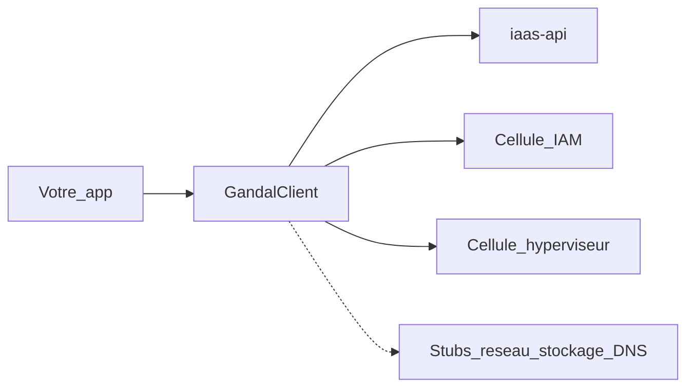

# Architecture

## Vue d'ensemble

Le SDK orchestre des **appels HTTP**. Il ne parle jamais a XAPI, au DNS ou au stockage directement : ce sont les cellules / le backend qui le font.

## Deux surfaces a ne pas confondre

| Besoin | Utiliser | Ne pas utiliser |
| --- | --- | --- |
| Creer une VM (demande admin) | `client.orchestration.vms` | `client.hypervisor` (sauf ops plateforme) |
| Reseaux / stockages metier | `client.orchestration.networks` / `storages` | `client.network` / `client.storage` (stubs) |
| Decision d'autorisation / quotas | `client.iam` + `GardeIam` | inventer des droits cote client |
| Entree SSH dans une VM | `AccesSsh` / `gandal-ssh` | cles permanentes dans `~/.ssh` |

## Ce que le SDK ne fait pas

- Gerer les comptes humains hors helpers auth orchestration
- Remplacer le **controle d'acces serveur** (`GardeIam` est consultatif / comptable cote client)
- Brancher les cellules encore en stub (leve `CellUnavailable`)

## Jetons

- **Orchestration** : `login` / `set_token` / `GANDAL_TOKEN`
- **IAM** : `set_iam_token` / `GANDAL_IAM_TOKEN` (souvent OIDC ou cle machine)
- **SSH** : `GANDAL_JETON` (distinct, pour le signeur)

Voir [Identifiants](identifiants.md).
